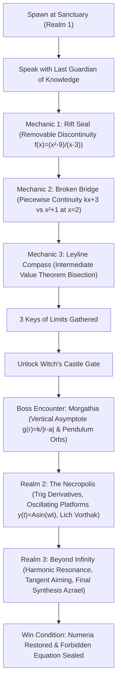

# GAME DESIGN DOCUMENT
## THE FORBIDDEN REALM: THE TRIALS OF KNOWLEDGE
**Differential Calculus Semestral Project (MATH 101)**  
*Batangas State University — The National Engineering University*  
*Course Facilitators: Engr. Hilarion S. Aquino III & Engr. James Marvin C. Gatdula*  
*Deployment:* [project20-beta-ashy.vercel.app](https://project20-beta-ashy.vercel.app) | *Repository:* [klein-sys/Baroha](https://github.com/klein-sys/Baroha)

---

## 1. Game Introduction

- **Title:** *The Forbidden Realm: The Trials of Knowledge*
- **Theme:** 3D Dark Fantasy Action-RPG & Celestial Mathematical Simulation.
- **Premise / Lore:**  
  The mystical Kingdom of Numeria has collapsed into chaos after the Dark Witch Morgathia, Lich King Vorthak, and the Cosmic Entity Azrael fractured reality by unleashing the *Forbidden Equation*. Dimensional barriers, celestial cycles, and physical architecture have become unstable, governed by mathematical laws of differential calculus. The player assumes the role of the *Arcane Guardian*, guided by the Last Guardian of Knowledge, embarking on an epic quest to stabilize boundaries, master instantaneous rates of change, shatter corrupted wards, and reunite the three Sacred Calculus Crystal Fragments to restore harmonic equilibrium.
- **Objective:**  
  Explore three distinct realms (The Cursed Forest, The Necropolis of Forgotten Kingdoms, and The Celestial Realm Beyond Infinity), stabilize removable discontinuities, repair piecewise bridges, navigate infinite vertical asymptotes, calculate critical turning points of harmonic oscillators, defeat the three bosses through active mathematical mechanics, and restore Numeria.
- **Target Players:**  
  Engineering students, mathematics undergraduates, educators, and gamers who enjoy deep, interactive 3D RPGs where differential calculus is not a detached trivia quiz, but the literal physical fabric and tactical rules governing the universe.

---

## 2. Platform, Players, Rules, Gameplay Sequence & Win/Lose Conditions

- **Platform:** Web Browser (WebGL / Three.js, responsive for desktop and mobile touch devices).
- **Player Mode:** Single-Player 3D Action RPG.
- **Camera Perspective:** Seamless toggle between Third-Person Roblox-style Orbit Camera and First-Person Immersive Viewmodel (`[V]`).
- **Core Rules:**
  1. *No Disconnected Quizzes:* The player never answers multiple-choice test questions. All differential calculus is experienced as direct gameplay mechanics: tuning resonance dials, matching approach limits, solidifying piecewise partitions, dodging vertical singularities, timing harmonic leaps at zero velocity ($v=0$), and charging spells to derivative crests.
  2. *Active Survival & Resource Management:* The player possesses Health (HP), Mana (MP), and 5 Sacred Hearts. Falling into abyssal voids or being struck by deadly asymptotic fields deducts hearts and health.
  3. *Continuous World Evaluation:* Celestial day/night lighting, monster aggression, oscillating platforms, and projectile tangent trajectories are computed dynamically per frame using pure mathematical differential calculus equations in `js/calculusEngine.js`.

### Gameplay Sequence per Level / Realm

- **Win Condition:**  
  Collect all three Sacred Calculus Crystal Fragments by mastering Limits and Trigonometric Derivatives, defeat the three bosses, and seal the Forbidden Equation at the Grand Cosmic Arena.
- **Lose Condition:**  
  Health drops to 0 or all 5 Sacred Hearts are depleted due to uncalculated leaps, staying inside asymptotic singularity danger zones, or monster attacks, resulting in respawn at the Sanctuary Checkpoint.

---

## 3. Differential Calculus Concepts & In-Game Mechanics

In strict accordance with the MATH 101 Semestral Project Rubric (30% Application of Differential Calculus), calculus is the core gameplay driver across two fundamental domains:

### Domain A: Limits and Continuity

1. **Rift Seals (Removable Discontinuity):**  
   - *Mathematical Formulation:* $f(x) = \frac{x^2 - 9}{x - 3}$.  
   - *Behavior:* Direct evaluation at $x = 3$ yields an indeterminate form $\frac{0}{0}$ (a removable hole). By factoring:
     $$\lim_{x \to 3} \frac{(x - 3)(x + 3)}{x - 3} = \lim_{x \to 3} (x + 3) = 6$$
   - *Gameplay Action:* The player tunes a spell resonance dial $x$. The live HUD displays the numerical approach table ($x = 2.9 \implies 5.9$, $x = 2.99 \implies 5.99$, $x = 3.01 \implies 6.01$). When the player approaches within $x \in [2.95, 3.05]$ without landing exactly on the undefined hole $x = 3.0$, the barrier resonates at exact power 6.0, shattering the seal and yielding Forest Key I.

2. **Broken Bridges (Piecewise Continuity):**  
   - *Mathematical Formulation:*  
     $$f(x) = \begin{cases} kx + 3, & x \le 2 \\ x^2 + 1, & x > 2 \end{cases}$$  
   - *Behavior:* Continuity at boundary $x = 2$ requires:
     $$\lim_{x \to 2^-} (kx + 3) = \lim_{x \to 2^+} (x^2 + 1) = f(2) \implies 2k + 3 = 5 \implies k = 1$$
   - *Gameplay Action:* Across a bottomless chasm, stone slabs flicker transparently with Jump Discontinuity $\Delta = |(2k + 3) - 5|$. The player cycles rune parameter $k \in \{-1, 0, 1, 2\}$. When $k = 1$, the jump vanishes ($\Delta = 0$), the bridge solidifies with full physical stone collision, allowing crossing to claim Forest Key II.

3. **Asymptotic Danger Zones (Infinite Limits & Vertical Singularities):**  
   - *Mathematical Formulation:* $g(r) = \frac{k}{|r - a|}$ where $a = 4.0\text{ m}$.  
   - *Behavior:* As radial distance $r \to a$, the denominator $|r - a| \to 0^+$, causing aura intensity and damage to blow up to infinity ($\lim_{r \to a} g(r) = +\infty$).  
   - *Gameplay Action:* In Morgathia's arena, a glowing purple ring marks $r = 4.0\text{ m}$. Entering $|r - 4.0| < 0.8$ inflicts rapid exponential damage. Safe kiting requires maintaining distance outside the singularity.

4. **Sanctuary Mana Springs (Horizontal Asymptote Plateau):**  
   - *Mathematical Formulation:* $M(t) = \frac{100t}{t + 5}$.  
   - *Behavior:* Evaluates horizontal behavior as $t \to \infty$:
     $$\lim_{t \to \infty} \frac{100t}{t + 5} = \lim_{t \to \infty} \frac{100}{1 + \frac{5}{t}} = 100$$
     Instantaneous recharge rate follows the quotient rule $\frac{dM}{dt} = \frac{500}{(t+5)^2}$, exhibiting diminishing returns as mana saturates towards the 100 MP plateau.

5. **Leyline Treasure Finder (Intermediate Value Theorem & Bisection):**  
   - *Mathematical Formulation:* Continuous energy function $f(x) = x^2 - 12$ on interval $[a, b] = [0, 6]$.  
   - *Behavior:* $f(0) = -12 < 0$ and $f(6) = 24 > 0$. Because $f(0) \cdot f(6) < 0$, IVT guarantees at least one root $c \in (0, 6)$ such that $f(c) = 0$ (algebraic root $\sqrt{12} \approx 3.464$).  
   - *Gameplay Action:* The player casts Seeker Pulse (Bisection). Each pulse evaluates midpoint $m = \frac{a+b}{2}$, determines sign change, and halves the search range. When interval width $|b - a| < 0.35$, the subterranean Leyline Core unseals, granting Forest Key III.

6. **Small-Angle Aiming Assist:**  
   - *Mathematical Formulation:* $\lim_{\theta \to 0} \frac{\sin\theta}{\theta} = 1.0$.  
   - *Gameplay Action:* When casting magic projectiles, the angular deflection $\theta$ between player crosshair and target determines aim magnetism. As aiming error $\theta \to 0$, assist factor converges smoothly to 1.0, pulling the trajectory directly into the target.

---

### Domain B: Basic Trigonometric Derivatives

1. **Calculus-Driven Celestial Day/Night Cycle:**  
   - *Mathematical Formulation:* Light level $L(t) = \sin(\omega t)$ where $\omega = \frac{2\pi}{24} = \frac{\pi}{12}\text{ rad/hour}$.  
   - *First Derivative:* $\frac{dL}{dt} = \omega \cos(\omega t)$ represents the rate of illumination change.  
   - *Gameplay Action:*  
     - $L > 0$ defines daylight; $L \le 0$ defines night.  
     - Nightfall begins **exactly once** at the downward zero-crossing ($t = 18.0\text{ h}$, 6:00 PM), where dimming rate $-\frac{dL}{dt}$ is at global maximum ($\omega \approx 0.262$).  
     - Monster aggression scales with dimming velocity $-\frac{dL}{dt}$, making dusk the most perilous hour. Midnight occurs at $\frac{dL}{dt} = 0$, where darkness reaches a steady minimum.

2. **Harmonic Oscillating Platforms:**  
   - *Mathematical Formulation:*  
     $$\text{Position: } y(t) = A \sin(\omega t) = 3.5 \sin(1.2 t)$$  
     $$\text{Velocity: } v(t) = y'(t) = A \omega \cos(\omega t) = 4.2 \cos(1.2 t)$$  
     $$\text{Acceleration: } a(t) = v'(t) = -A \omega^2 \sin(\omega t) = -5.04 \sin(1.2 t)$$  
   - *Gameplay Action:* Peak vertical displacements occur when velocity vanishes ($v(t) = 0$). At these turning points, the platform glows emerald green ("SAFE TO BOARD"). Attempting to board during maximum kinetic velocity ($|v| = 4.2\text{ m/s}$) causes player slip and kinetic shock.

3. **Pendulum Orbital Hazards:**  
   - *Mathematical Formulation:* Angular position $\theta(t) = \theta_0 \cos(\omega t)$; angular velocity $\dot{\theta}(t) = -\theta_0 \omega \sin(\omega t)$.  
   - *Gameplay Action:* Boss necrotic barrier orbs sweep through arcs. At extreme amplitudes $\theta = \pm \theta_0$, angular speed drops to zero ($\dot{\theta} = 0$). Players identify these turning points to safely dash through gaps without collision.

4. **Sine Projectile & Tangent Aiming:**  
   - *Mathematical Formulation:* Wave trajectory $y(x) = A \sin(kx)$; tangent slope $m = \frac{dy}{dx} = A k \cos(kx)$.  
   - *Gameplay Action:* Boss weak-point shields overload only when struck by tangent rays matching target slopes ($m = 0$ at crests or $m = 1$).

5. **Spell Pulse Timing (Extrema & Critical Points):**  
   - *Mathematical Formulation:* Pulse charge power $D(t) = 20 + 80 \sin(\omega t)$; power rate $D'(t) = 80 \omega \cos(\omega t)$.  
   - *Gameplay Action:* Releasing charge when $D'(t) = 0$ (at crest) triggers a "CRITICAL CALCULUS SURGE" dealing $2\times$ amplified damage.

---

## 4. Worked Step-by-Step Mathematical Examples

### Worked Example 1: Rift Seal Discontinuity via Limits (Domain A)

- **Scenario:** In Realm 1 (The Cursed Forest), a corrupted boundary prevents access to the northern fortress. The barrier's energy is modeled by:
  $$f(x) = \frac{x^2 - 9}{x - 3}$$
- **Step 1: Test Direct Substitution at Boundary $x = 3$**
  $$f(3) = \frac{3^2 - 9}{3 - 3} = \frac{9 - 9}{0} = \frac{0}{0} \quad (\text{Indeterminate Form})$$
  Direct substitution fails because division by zero is undefined. The function possesses a point singularity (hole) at $x = 3$.
- **Step 2: Algebraic Factorization (Difference of Two Squares)**
  $$x^2 - 9 = (x - 3)(x + 3)$$
- **Step 3: Simplify for all $x \ne 3$**
  $$\lim_{x \to 3} \frac{(x - 3)(x + 3)}{x - 3} = \lim_{x \to 3} (x + 3)$$
- **Step 4: Construct Numerical Two-Sided Approach Table**
  | Approach Direction | $x$ | $f(x) = x + 3$ |
  | :--- | :--- | :--- |
  | Left-Hand ($x \to 3^-$) | $2.90$ | $5.90$ |
  | Left-Hand ($x \to 3^-$) | $2.99$ | $5.99$ |
  | Exact Point | $3.00$ | **UNDEFINED (0/0 Hole)** |
  | Right-Hand ($x \to 3^+$) | $3.01$ | $6.01$ |
  | Right-Hand ($x \to 3^+$) | $3.10$ | $6.10$ |
- **Step 5: Compute the Exact Limit**
  $$\lim_{x \to 3^-} f(x) = \lim_{x \to 3^+} f(x) = 3 + 3 = 6.00$$
- **Interpretation & In-Game Effect:**  
  Standing directly on $x = 3.00$ triggers a severe runic fizzle because $f(3)$ is undefined. By tuning the dial to $x = 2.99$ or $x = 3.01$, the player channels resonance energy of $6.00$ units, shattering the seal and releasing Forest Key of Limits I.

---

### Worked Example 2: Harmonic Platform Oscillation & Critical Leap Velocity (Domain B)

- **Scenario:** In Realm 2 (The Forgotten Kingdom), a floating crystalline elevator oscillates vertically above a spike pit. Its elevation is given by:
  $$y(t) = 3.5 \sin(1.2 t) \quad (\text{meters})$$
- **Step 1: Identify Kinematic Functions via Differentiation**
  - Position: $y(t) = 3.5 \sin(1.2 t)$
  - Apply Chain Rule $\frac{d}{dt}[\sin(u)] = \cos(u) \cdot \frac{du}{dt}$ where $u = 1.2 t$:
    $$v(t) = y'(t) = 3.5 \cdot 1.2 \cdot \cos(1.2 t) = 4.2 \cos(1.2 t) \quad (\text{m/s})$$
  - Acceleration (Second Derivative):
    $$a(t) = v'(t) = y''(t) = 4.2 \cdot (-1.2) \cdot \sin(1.2 t) = -5.04 \sin(1.2 t) \quad (\text{m/s}^2)$$
- **Step 2: Find Critical Turning Points Where Velocity Vanishes ($v(t) = 0$)**
  $$4.2 \cos(1.2 t) = 0 \implies \cos(1.2 t) = 0$$
  $$1.2 t = \frac{\pi}{2} + n\pi \implies t = \frac{\pi}{2.4} \approx 1.309\text{ seconds} \quad (\text{for } n = 0)$$
- **Step 3: Evaluate Position and Acceleration at First Stationary Peak ($t = 1.309\text{ s}$)**
  - Position: $y(1.309) = 3.5 \sin(1.2 \cdot 1.309) = 3.5 \sin(\pi/2) = 3.5(1) = +3.50\text{ m}$
  - Velocity: $v(1.309) = 4.2 \cos(\pi/2) = 0.00\text{ m/s}$
  - Acceleration: $a(1.309) = -5.04 \sin(\pi/2) = -5.04\text{ m/s}^2$
- **Interpretation & In-Game Effect:**  
  At $t = 1.309\text{ s}$, the platform reaches its peak altitude ($+3.5\text{ m}$) and is instantaneously stationary ($v = 0$). In-game, the platform pulses radiant emerald green when $|v| < 0.35\text{ m/s}$. Leaping onto the platform at this moment guarantees zero relative velocity and a flawless landing. Attempting to board at $t = 0\text{ s}$ (where velocity is at global maximum $v = 4.2\text{ m/s}$) results in slippage and falls.

---

## 5. Mathematical Significance: How Calculus Drives Player Decisions

1. **Strategic Movement Over Brute Force:**  
   Players cannot simply run blindly through levels. In asymptotic zones ($g(r) = \frac{15}{|r - 4|}$), player positioning requires respecting geometric thresholds derived from infinite limit behavior.
2. **Timing Grounded in Instantaneous Rates of Change:**  
   Instead of arbitrary rhythm games, combat and platforming are synchronized with physical first and second derivatives. The celestial cycle enforces tactical urgency: knowing that $-\frac{dL}{dt}$ peaks at dusk ($18:00$), players prepare defenses before nightfall occurs.
3. **Problem Solving Through Continuous Functions:**  
   The Intermediate Value Theorem is experienced as an active binary search (bisection) where players physically narrow search regions based on sign changes of continuous functions.

---

## 6. Rubric Mapping Table (BSU Semestral Project Guidelines)

| Rubric Criterion | Weight | How & Where It Is Met in "The Forbidden Realm" | File Reference |
| :--- | :---: | :--- | :--- |
| **Application of Differential Calculus** | **30%** | Both required topics (A: Limits & Continuity; B: Basic Trig Derivatives) are core interactive gameplay systems. Zero detached trivia quizzes. Pure pure functions compute exact mathematical outcomes with unit tests. | [`js/calculusEngine.js`](file:///c:/Users/dxzmw/Downloads/baroha/js/calculusEngine.js) [`js/world.js`](file:///c:/Users/dxzmw/Downloads/baroha/js/world.js) [`tests/run-all-tests.js`](file:///c:/Users/dxzmw/Downloads/baroha/tests/run-all-tests.js) |
| **Programming & Functionality** | **20%** | Full WebGL 3D RPG with Roblox 3rd-person/1st-person camera, sound engine, inventory, hotbar, day/night lighting, and zero console/DOM errors. Notification manager prevents DOM bloat; character pivot snaps feet to terrain on flats and slopes. | [`js/player.js`](file:///c:/Users/dxzmw/Downloads/baroha/js/player.js) [`js/character.js`](file:///c:/Users/dxzmw/Downloads/baroha/js/character.js) [`js/interface.js`](file:///c:/Users/dxzmw/Downloads/baroha/js/interface.js) |
| **Presentation & Defense** | **20%** | Comprehensive `GAME_DESIGN.md` document, live telemetry reference codex (`[M]`), LaTeX-verified worked examples, and dev options panel for instant faculty demonstrations. | [`GAME_DESIGN.md`](file:///c:/Users/dxzmw/Downloads/baroha/GAME_DESIGN.md) [`js/calculus.js`](file:///c:/Users/dxzmw/Downloads/baroha/js/calculus.js) [`js/dev.js`](file:///c:/Users/dxzmw/Downloads/baroha/js/dev.js) |
| **Game Mechanics & Rules** | **15%** | Functional objectives, quest journal, health/mana survival, inventory consumables, win/lose conditions, and interactive calculus puzzles (Rift Seals, Piecewise Bridges, Leyline Bisection). | [`js/missions.js`](file:///c:/Users/dxzmw/Downloads/baroha/js/missions.js) [`js/game.js`](file:///c:/Users/dxzmw/Downloads/baroha/js/game.js) [`js/inventory.js`](file:///c:/Users/dxzmw/Downloads/baroha/js/inventory.js) |
| **Concept & Creativity** | **15%** | High-concept integration where mathematical equations are transformed into physical architecture, celestial illumination, and combat dynamics in an engaging 3D fantasy world. | [`js/daynight.js`](file:///c:/Users/dxzmw/Downloads/baroha/js/daynight.js) [`js/world.js`](file:///c:/Users/dxzmw/Downloads/baroha/js/world.js) |

---

## 7. Faculty Demonstration Guide (Quick Dev Options)

To assist course facilitators (Engr. Aquino & Engr. Gatdula) during evaluation:
- Press **`~`** (Tilde) or click **`DEV`** in the top left header to toggle the Faculty Developer Console.
- **Cheats / God Mode:** Enable God Mode, Max Level 4, Noclip Fly, or Instant Boss Kill.
- **Calculus Diagnostics:** Click "Run Calculus Diagnostics" to execute in-engine automated proofs verifying all differential formulas.
- **Codex Reference:** Press **`[M]`** anytime to inspect live mathematical telemetry and step-by-step worked proofs.

