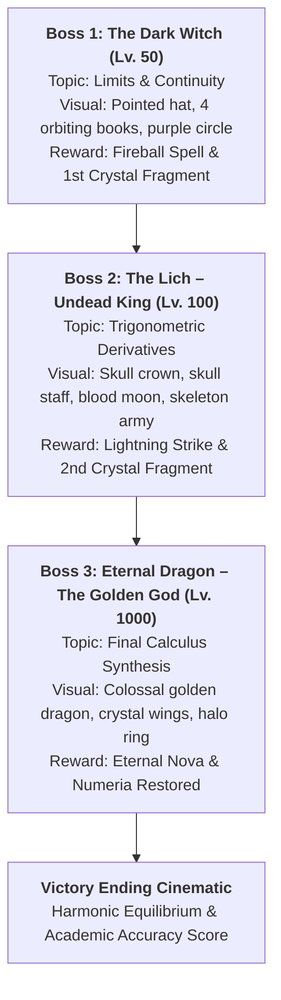
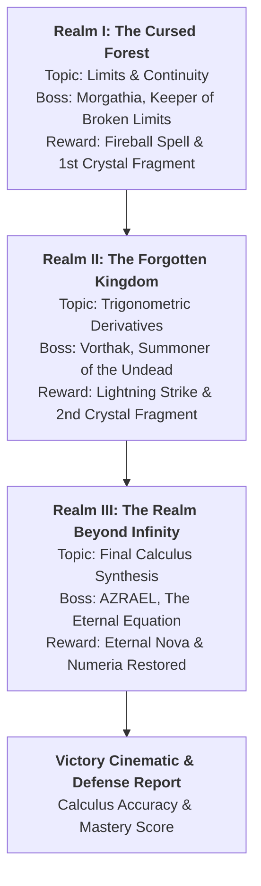

x # ⚔️ MATHBOUND – LEGENDS OF THE THREE BOSSES
### The Forbidden Realm: The Trials of Knowledge
#### A Roblox-Inspired 3D Fantasy Adventure RPG Featuring Differential Calculus

[](https://github.com/klein-sys/Baroha)
[](https://klein-sys.github.io/Baroha/)
[](https://vercel.com/new/clone?repository-url=https%3A%2F%2Fgithub.com%2Fklein-sys%2FBaroha)
[](https://www.batstate-u.edu.ph/)
[](https://threejs.org/)
[](https://www.roblox.com/)

> **Batangas State University - The National Engineering University**  
> **College of Informatics and Computing Sciences**  
> **Course:** MATH 101 – Differential Calculus  
> **Semestral Project:** Designing Digital Worlds Through Differential Calculus  
> **Course Facilitators:** Engr. Hilarion S. Aquino III & Engr. James Marvin C. Gatdula  
> **Repository:** [https://github.com/klein-sys/Baroha](https://github.com/klein-sys/Baroha)  
> **Live Gameplay:** [https://klein-sys.github.io/Baroha/](https://klein-sys.github.io/Baroha/)

---

## Current build — Four-Floor Dungeon

Start in the Cursed Forest sanctuary and descend through the Forgotten Kingdom and the Celestial Depths to Beyond Infinity. Each floor has connected rooms, a Rift Seal, a continuity bridge, a harmonic lift to an optional side chamber, timed traps, and a boss arena. Tune the Rift Seal close to x = 3 and set the bridge rune to k = 1. Defeat the floor boss to open the portal at the back of the arena. The game saves puzzle, loot, and portal progress locally.

Use **T** for the floor map, **V** to switch perspectives, and **Q** to cast the selected spell. On touch screens, use the joystick to move and drag the scene to look while using the action buttons. The pause menu contains the journal, inventory, and settings.

Run `npm test` to check the game logic and model integration. Run `npm start` to play locally, or extract the standalone ZIP and open `index.html`.

The sections below include the original project background and reference material.

## 🌟 1. Project Overview & Roblox-Inspired Vision

**MATHBOUND – Legends of the Three Bosses** is a complete, polished, fully explorable 3D third-person adventure RPG powered by Three.js WebGL. Transforming conventional mathematics homework into an immersive fantasy epic, this game integrates differential calculus—including **Limits**, **Continuity**, **Algebraic Factoring**, and **Trigonometric Derivatives**—directly into high-stakes action combat and survival exploration.

This is **not** a simple quiz website:
- **Playable 3D Roblox Character:** Procedural blocky character model featuring head, spiked anime hair, adventurer cape, torso with gold trim belt, shoulder and hip pivot joints, animated swinging greatsword, and smooth 3rd-person orbital follow camera. Supports instant 1st/3rd person toggle with **`V`**.
- **Three Epic Bosses with Custom Visual Bodies:**
  1. **The Dark Witch (Lv. 50):** Pointed witch hat with purple gem brooch, flowing dark robes, 4 orbiting chained spellbooks, and giant glowing purple magic circle (*Image 1*).
  2. **The Lich – Undead King (Lv. 100):** Skeleton king with spiked crimson crown, glowing red skull staff in a spiked wheel, floating red tarot runes, blood-red moon, and summoned 3D Skeleton Warriors (*Image 2*).
  3. **Eternal Dragon – The Golden God (Lv. 1000):** Colossal final boss with golden crystalline wings, celestial halo ring, golden horns, fire breath, meteor rain, and 3 combat phases (*Image 3*).
- **Four Connected Explorable Regions:** The Beginner Kingdom (Grasslands & Village Inn), The Haunted Forest, The Cursed Kingdom, and The Golden Dragon Realm.
- **Dynamic 24-Hour Day & Night Cycle:** Complete sun and moon orbital lighting, atmospheric fog color shifts, and aggressive nighttime monster spawns.
- **Interactive Bed & Sleeping System:** Village Inn bed at `(0, 0, 25)`. Pressing **`E`** prompts the sleeping dialog; resting skips the perilous night to **6:00 AM Sunrise**, despawns night monsters, and restores **100% HP & Mana**.
- **Interactive World Map (`T`):** Fullscreen fantasy map displaying color-coded regions, safe zones, NPCs, quest markers, danger gates, and real-time player location (`YOU`).
- **Mathematically Sound Randomized Questions:** Strict Fisher-Yates choice shuffling so correct answers are evenly and unpredictably distributed among **A, B, C, and D** with zero duplicate questions per encounter.

---

## 🕹️ 2. Game Controls & Input Guide

The game is designed for desktop keyboard/mouse and touchscreen mobile devices.

| Key / Input | Action | In-Game Mechanics |
| :--- | :--- | :--- |
| **W, A, S, D** | Movement | Walk forward, left, backward, and right |
| **Mouse Look** | Camera Orbit | 360° smooth camera orbit with Pointer Lock |
| **Space** | Jump | Leap over obstacles, ruins, and chasm gaps |
| **Shift** (Hold) | Sprint / Dash | Accelerates movement from 8 to 14 units/sec |
| **Left Click (LMB)** | Greatsword Attack | 3D sword swing animation with blade trail & hitmarker |
| **Right Click (RMB)**| Block / Parry | Defensive stance reducing incoming damage by 60% |
| **1, 2, 3, 4, 5** | Magic Abilities | Cast Magic Bolt, Fireball, Lightning, Shield, Nova |
| **E / F** | Interact / Bed | Speak with NPCs, open chests, collect keys, sleep in Inn bed |
| **T** | World Map | Open interactive map with real-time player GPS pin |
| **V** | Camera View | Toggle between 3rd-Person (Roblox) and 1st-Person camera |
| **Tab** | Quest Journal | View active realm objectives and achievements |
| **I** | Inventory | Open satchel to consume Healing Potions (+50 HP) or Mana Crystals |
| **C** | Character Status | View Level, HP, Mana, Attack Power, and Accuracy % |
| **M** | Calculus Codex | Study formulas, definitions, and worked examples |
| **H** | Controls Guide | Open the interactive Controls manual |
| **O** | Settings | Adjust Graphics, Resolution Scale, FOV, Sensitivity, and Audio |
| **F1** or **`** | Dev Console | Open Developer Suite: God Mode, Noclip, Teleport, Boss Spawner, Cheats |
| **Esc** | Pause Menu | Pause game, restart realm, or adjust settings |

> 📱 **Mobile Touch Controls:** On phones or tablets, an on-screen virtual joystick and floating action buttons (`SWORD`, `JUMP`, `CAST`, `USE`, `POTION`, `QUEST`, `GUIDE`, `OPT`, `DEV`) appear automatically.

---

## 🕒 3. Day and Night Cycle & Bed Sleeping System

The world of Numeria operates on an automated 24-hour astronomical clock:
- **6:00 AM – Sunrise:** Golden dawn light breaks across the grasslands.
- **7:00 AM to 5:00 PM – Peaceful Daytime:** Low monster density, clear blue skies, NPCs active, ideal for exploration and questing.
- **5:00 PM to 7:00 PM – Sunset:** Warm orange horizon transition.
- **7:00 PM to 5:00 AM – Dangerous Nighttime:** Deep dark sky, heavy fog, increased monster spawn rates, aggressive night stalkers roam the wild.
- **Interactive Bed System:** Inside the Beginner Village Inn at `(0, 0, 25)`, approach the bed and press **`E`** to open the sleep dialog:
  - Fades the screen smoothly to black.
  - Automatically advances in-game time directly to **6:00 AM Sunrise**.
  - Restores the player's **HP and Mana to 100%**.
  - Despawns all nighttime monsters and returns peaceful daytime music.

---

## 🗺️ 4. Interactive World Map System (`T`)

Pressing **`T`** pauses player movement and opens the high-resolution vector world map:
- **Discovered Regions:**
  - 🟩 **The Beginner Kingdom:** Peaceful grasslands, starter village, Inn with sleeping bed, training dummies.
  - 🟪 **The Haunted Forest:** Dark twisted woodlands, domain of **The Dark Witch (Lv. 50)**.
  - 🟥 **The Cursed Kingdom:** Gothic cathedral ruins, graveyard, domain of **The Lich (Lv. 100)**.
  - 🟨 **The Golden Dragon Realm:** Floating celestial islands, domain of **Eternal Dragon (Lv. 1000)**.
- **Color-Coded Map Markers:**
  - 🟢 **Safe Locations:** Starter Village & Adventurer's Inn Bed (`0, 25`).
  - 🔵 **NPCs & Quests:** Elder of Numeria (`0, 12`), Hermit Scholar Alistair (`-14, -55`).
  - 🔴 **Danger Gates:** Haunted Forest Gates (`0, -25`), Cursed Crypt Gate (`0, -85`).
  - 🟣 **Boss Arenas:** The Dark Witch (`0, -45`), The Lich (`0, -115`), Eternal Dragon (`0, -185`).
  - 🟡 **Sacred Relics:** Relic of Limits (`18, -35`), Golden Heart of Eternity (`-22, -95`).
- **Live GPS Marker:** Glowing pulsing gold indicator showing current player coordinates (`YOU`).

---

## 👑 5. The Three Bosses & Calculus Curriculum



### Boss 1: The Dark Witch – Morgathia (Lv. 50)
- **Visual Design (Image 1):** Flowing dark violet robes, pointed witch hat with amethyst gem brooch, long silver hair, glowing purple eyes, 4 chained spellbooks orbiting her body, and a massive glowing purple magic circle behind her.
- **Educational Topic: Limits & Continuity**
  - Direct substitution limits: $\lim_{x \to 3} (2x^2 - 4x + 5) = 11$.
  - Factoring indeterminate forms $\frac{0}{0}$: $\lim_{x \to 4}\frac{x^2 - 16}{x - 4} = 8$.
  - Conjugate multiplication for radicals: $\lim_{x \to 0}\frac{\sqrt{x+9}-3}{x} = \frac{1}{6}$.
  - Limits at infinity: $\lim_{x \to \infty}\frac{6x^2+7x-2}{2x^2-5x+3} = 3$.
  - Piecewise continuity conditions: finding $k$ such that $\lim_{x \to c^-} f(x) = \lim_{x \to c^+} f(x)$.

### Boss 2: The Lich – Undead King (Lv. 100)
- **Visual Design (Image 2):** Towering armored skeleton king with spiked crimson crown, skull staff within a spiked iron wheel, floating red tarot runes, red glowing eyes, flanked by summoned 3D Skeleton Warriors under a giant blood-red moon.
- **Educational Topic: Trigonometric Derivatives**
  - Core identities: $\frac{d}{dx}[\sin x] = \cos x$, $\frac{d}{dx}[\cos x] = -\sin x$, $\frac{d}{dx}[\tan x] = \sec^2 x$.
  - Reciprocal identities: $\frac{d}{dx}[\sec x] = \sec x \tan x$, $\frac{d}{dx}[\csc x] = -\csc x \cot x$, $\frac{d}{dx}[\cot x] = -\csc^2 x$.
  - Trigonometric Chain Rule: $\frac{d}{dx}[\sin(4x)] = 4\cos(4x)$, $\frac{d}{dx}[\cos(3x^2)] = -6x\sin(3x^2)$.
  - Product rule combinations: $\frac{d}{dx}[x^2\sin x] = 2x\sin x + x^2\cos x$.

### Boss 3: Eternal Dragon – The Golden God (Lv. 1000 Final Boss)
- **Visual Design (Image 3):** Colossal golden dragon, faceted crystalline gold wings, glowing celestial halo ring, golden horns, segmented thick health bar, golden fire breath, and meteor rain.
- **Educational Topic: Comprehensive Calculus Mastery**
  - Higher-order derivatives: $\frac{d^2}{dx^2}[\cos(2x)] = -4\cos(2x)$.
  - Critical points & curve analysis: $f'(x) = 3x^2 - 3 = 0 \implies x = \pm 1$.
  - Instantaneous rates of change & velocity: $v(t) = s'(t) = 8t - 2$.
  - Special trigonometric limits: $\lim_{x \to 0}\frac{1 - \cos x}{x^2} = 0.5$.

---

## 🏰 6. The Three Progressive Realms & Boss Encounters



### Level 1: The Witch's Cursed Forest
- **Boss:** *Morgathia, Keeper of Broken Limits* (300 HP, 3 Phases)
- **Environment:** Dark misty woodlands, twisted gothic trees, bioluminescent mushrooms, ruined cottages, and Morgathia's Cursed Castle.
- **Educational Topic: Limits & Continuity**
  - Evaluating limits via direct substitution: $\lim_{x \to 3} (2x^2 - 4x + 5) = 11$.
  - Resolving $\frac{0}{0}$ indeterminate forms by factoring: $\lim_{x \to 4}\frac{x^2 - 16}{x - 4} = 8$.
  - Conjugate multiplication for radical expressions: $\lim_{x \to 0}\frac{\sqrt{x+9}-3}{x} = \frac{1}{6}$.
  - Limits at infinity / horizontal asymptotes: $\lim_{x \to \infty}\frac{6x^2+7x-2}{2x^2-5x+3} = 3$.
  - Determining piecewise parameters $k$ ensuring continuity: $\lim_{x \to c^-} f(x) = \lim_{x \to c^+} f(x)$.
- **Rewards:** 500 XP, *Apprentice Mage* title, unlock **Fireball**, First Sacred Crystal Fragment.

### Level 2: The Necromancer's Forgotten Kingdom
- **Boss:** *Vorthak, Summoner of the Undead* (450 HP, 4 Phases)
- **Environment:** Crumbling gothic cathedral arches, cobblestone avenues, weathered tombstone cemetery, green spectral braziers, and the Crypt Portal.
- **Educational Topic: Basic Trigonometric Derivatives**
  - Fundamental derivatives: $\frac{d}{dx}[\sin x] = \cos x$, $\frac{d}{dx}[\cos x] = -\sin x$, $\frac{d}{dx}[\tan x] = \sec^2 x$.
  - Reciprocal functions: $\frac{d}{dx}[\sec x] = \sec x \tan x$, $\frac{d}{dx}[\csc x] = -\csc x \cot x$, $\frac{d}{dx}[\cot x] = -\csc^2 x$.
  - Trigonometric Chain Rule: $\frac{d}{dx}[\sin(4x)] = 4\cos(4x)$, $\frac{d}{dx}[\cos(3x^2)] = -6x\sin(3x^2)$.
  - Product Rule with Trigonometry: $\frac{d}{dx}[x^2\sin x] = 2x\sin x + x^2\cos x$.
  - Tangent slopes & instantaneous rates of change: $\left. \frac{d}{dx}[3\sin x] \right|_{x=0} = 3$.
- **Summoned Undead:** Skeleton Scholars, Undead Knights, Phantom Mages, and Cursed Guardians.
- **Rewards:** 1,000 XP, *Lich Hunter* title, unlock **Lightning Strike**, Second Sacred Crystal Fragment.

### Level 3: The Realm Beyond Infinity
- **Final Boss:** *AZRAEL, THE ETERNAL EQUATION* (650 HP, 4 Phases)
- **Environment:** Floating celestial marble platforms suspended in cosmic space, orbiting golden mathematical rings, three Ancient Dimensional Towers, and the Grand Final Arena.
- **Educational Topic: Final Calculus Trial**
  - Higher-order trigonometric derivatives: $\frac{d^2}{dx^2}[\cos(2x)] = -4\cos(2x)$.
  - Critical points, local extrema, and concavity tests: $f'(x) = 3x^2 - 3 = 0 \implies x = \pm 1$.
  - Instantaneous rate of change / velocity in physics: $v(t) = s'(t) = 8t - 2$.
  - Multi-step trigonometric limit quotients: $\lim_{x \to 0}\frac{1 - \cos x}{x^2} = 0.5$.
- **Rewards:** 2,000 XP, *Legendary Guardian* title, unlock **Eternal Nova**, Final Sacred Crystal Fragment, Restoration of Numeria Ending Cinematic.

---

## 💖 7. Survival Rules, RPG Progression & Settings

### The Five Hearts (Lives) System
- The player begins with exactly **5 Hearts (Lives)**, visible on the top-left HUD.
- **Physical Damage:** Normal minion attacks deplete your green Health Bar (HP). If your HP falls to 0, you lose **1 Heart** and respawn at the Sanctuary Checkpoint with full HP.
- **Boss Combat Calculus Curses:** In boss encounters, the boss periodically casts mathematical attack spells. An **incorrect answer immediately costs 1 Heart**! A **correct answer deals massive counter-damage** to the boss!
- **Golden Hearts:** Rare collectibles hidden in ruins and mystery chests that restore lost heart containers up to the maximum of 5.
- **Randomized Answer Distribution:** Answer options are strictly shuffled using the Fisher-Yates algorithm, ensuring correct answers appear across **A, B, C, and D** rather than any fixed position. Duplicate questions in the same encounter are automatically prevented.
- **Game Over & Checkpoints:** If all 5 Hearts are depleted, you enter the Game Over screen with a **Retry from Checkpoint** option.

### RPG Leveling & Stat Scaling
- Defeating monsters, solving calculus trials, opening mystery chests, and vanquishing bosses awards **Experience Points (XP)**.
- **Level Curve:**
  - **Level 1 (Novice Adventurer):** 100 HP, 100 MP, 35 Attack. Spells: *Magic Bolt*, *Magical Shield*, *Healing Aura*.
  - **Level 2 (Apprentice Mage):** 125 HP, 120 MP, 45 Attack. Unlocks: *Fireball*.
  - **Level 3 (Lich Hunter):** 150 HP, 140 MP, 55 Attack. Unlocks: *Lightning Strike*.
  - **Level 4 (Legendary Guardian):** 175 HP, 160 MP, 65 Attack. Unlocks: *Eternal Nova*.

### Graphics & Performance Settings (`O`)
- **Atmospheric Fog & View Distance:** Short (Dense Fog / High FPS), Medium (Balanced), Far (Panoramic Vista).
- **Framerate Limiter (FPS Cap):** `30 FPS (Power Saver)`, `60 FPS (Smooth)`, or `Uncapped (Max Display Refresh)`.
- **Controls & Sensitivity:** Mouse sensitivity slider (0.5x to 3.0x), Invert Y-axis toggle, and Mobile UI visibility.
- **Audio System:** Sliders for Master, Music, and SFX volumes + Mute toggle.
- **Persistence:** All preferences are saved automatically in `localStorage`.

---

## 📐 8. Semestral Project Worked Examples (Defense Guide)

### Worked Example 1: Energy Bridge Stabilization via Limits
- **Course Concept:** Limits of Rational Functions & Removable Discontinuities
- **Context:** In Level 1, a collapsed stone bridge requires determining the limiting altitude as coordinate $x \to 3$:
$$\lim_{x \to 3} \frac{x^2 - 9}{x - 3}$$
- **Step-by-Step Solution:**
  1. Test direct substitution $x = 3$:
     $$\frac{3^2 - 9}{3 - 3} = \frac{0}{0} \quad \text{(Indeterminate Form)}$$
  2. Factor the difference of squares in the numerator:
     $$x^2 - 9 = (x - 3)(x + 3)$$
  3. Cancel the common factor $(x - 3)$ for all $x \ne 3$:
     $$\lim_{x \to 3} \frac{(x - 3)(x + 3)}{x - 3} = \lim_{x \to 3} (x + 3)$$
  4. Substitute $x = 3$:
     $$3 + 3 = 6 \text{ units}$$
- **Gameplay Effect:** Entering the exact limiting value of **6** locks the bridge into continuous alignment, allowing safe passage across the chasm and dealing 35 damage to Morgathia's outer ward.

### Worked Example 2: Overloading the Lich's Shield with Trig Derivatives
- **Course Concept:** Chain Rule with Trigonometric Functions
- **Context:** In Level 2, Lich King Vorthak casts an oscillating necrotic barrier with energy profile $E(t) = 5\sin(3t)$. The player must find the instantaneous rate of change of energy at $t = 0$:
$$\left. \frac{dE}{dt} \right|_{t=0}$$
- **Step-by-Step Solution:**
  1. Let outer function $f(u) = 5\sin(u)$ and inner function $u(t) = 3t$.
  2. Derivative of outer function: $f'(u) = 5\cos(u)$.
  3. Derivative of inner function: $u'(t) = 3$.
  4. Apply Chain Rule:
     $$\frac{dE}{dt} = 5\cos(3t) \cdot 3 = 15\cos(3t)$$
  5. Evaluate at $t = 0$:
     $$\left. \frac{dE}{dt} \right|_{t=0} = 15\cos(0) = 15(1) = 15 \text{ MW/s}$$
- **Gameplay Effect:** Solving for **15** triggers a harmonic overload, shattering Vorthak's invulnerability shield and leaving him vulnerable to physical sword slashes.

### Worked Example 3: Banishing the Forbidden Equation via Second-Order Derivatives
- **Course Concept:** Second-Order Derivatives & Simple Harmonic Motion
- **Context:** In Level 3, Azrael casts an orbital wave equation $\Psi(x) = 2\cos(4x)$. The player must compute the second derivative $\frac{d^2\Psi}{dx^2}$ to tune the Sacred Crystals to anti-phase resonance:
- **Step-by-Step Solution:**
  1. First derivative using chain rule:
     $$\frac{d\Psi}{dx} = 2 \cdot (-\sin(4x)) \cdot 4 = -8\sin(4x)$$
  2. Second derivative using chain rule:
     $$\frac{d^2\Psi}{dx^2} = -8 \cdot (\cos(4x)) \cdot 4 = -32\cos(4x)$$
  3. Interpretation: $\frac{d^2\Psi}{dx^2} = -16\Psi(x)$, demonstrating harmonic oscillation with frequency $\omega = 4$.
- **Gameplay Effect:** The anti-phase wave dissolves Azrael's dimensional tether, initiating the final sequence where all three crystal fragments unite to seal the Forbidden Equation forever.

---

## 💻 9. Technical Architecture & File Directory

```
klein-sys/Baroha/
├── index.html                  # Master application entry point & HUD layout
├── README.md                   # Full academic report, lore, controls & defense guide
├── .gitignore                  # Git ignore rules for clean repository
├── vercel.json                 # Vercel deployment configuration
├── package.json                # Project metadata & local dev scripts
├── TheForbiddenRealm3D.zip     # Complete offline distributable bundle
├── tests/
│   └── run-all-tests.js        # Comprehensive automated verification suite (65+ assertions)
├── css/
│   └── style.css               # Dark fantasy styling, HUD, modals, KaTeX math cards
└── js/
    ├── three.min.js            # Three.js r128 3D WebGL engine
    ├── audio.js                # Web Audio API procedural synthesizer (music & SFX)
    ├── calculus.js             # Calculus problem generator, explanations & worked examples
    ├── daynight.js             # 24-hr day/night cycle, orbital lighting, and bed sleeping
    ├── player.js               # 3D player controller, Runeblade viewmodel, survival
    ├── character.js            # 3D Roblox character model, limb animations, orbit camera
    ├── abilities.js            # Spells (Magic Bolt, Fireball, Lightning, Shield, Nova)
    ├── bosses.js               # 3D Bosses: Dark Witch, The Lich, and Eternal Dragon
    ├── world.js                # 3D procedural realms, trees, cathedral ruins, floating islands
    ├── enemies.js              # Minion pathfinding AI, projectile attacks & 3 Boss machines
    ├── missions.js             # Quest journal, keys collection tracker & achievements
    ├── inventory.js            # Potions, mana crystals, golden hearts, artifacts
    ├── progression.js          # LocalStorage save/load & level scaling
    ├── settings.js             # Dedicated Settings Manager (graphics, resolution, audio)
    ├── map.js                  # Interactive World Map canvas with GPS player locator
    ├── dev.js                  # Complete Developer Console Suite, cheats, telemetry & test harness
    ├── interface.js            # HUD updates, damage numbers, dialogs & touch controls
    ├── game.js                 # Core game loop, combat hit detection & scene manager
    └── main.js                 # Event listeners, menu bindings & initialization
```

---

## 🌐 10. How to Enable GitHub Pages (Play in Browser)

1. Open your repository on GitHub: [https://github.com/klein-sys/Baroha](https://github.com/klein-sys/Baroha).
2. Go to **Settings** (tab at the top right).
3. In the left sidebar, click **Pages** (under the "Code and automation" section).
4. Under **Build and deployment > Branch**:
   - Select **Branch:** `main`
   - Select **Folder:** `/ (root)`
   - Click **Save**.
5. Wait 30–60 seconds. Your game will be live worldwide at:  
   👉 **[https://klein-sys.github.io/Baroha/](https://klein-sys.github.io/Baroha/)**!

---

## 🚀 11. How to Publish / Deploy to Vercel

You can publish this project to Vercel in 1 click:

[](https://vercel.com/new/clone?repository-url=https%3A%2F%2Fgithub.com%2Fklein-sys%2FBaroha)

### Step-by-Step Vercel Deployment:
1. Go to [vercel.com](https://vercel.com/) and sign in with your GitHub account.
2. Click **"Add New..."** > **"Project"**.
3. Under **"Import Git Repository"**, locate and click **"Import"** next to **`klein-sys/Baroha`**.
4. In the Project Configuration screen:
   - **Framework Preset:** `Other` (Static HTML/JS)
   - **Root Directory:** `./`
   - **Build & Output Settings:** Leave default (no build step required)
5. Click **"Deploy"**.
6. In ~15 seconds, your game is live with an official Vercel URL (e.g., `https://baroha.vercel.app`), SSL certificate, and automated continuous deployment on every Git push!

---

## 🛠️ 12. Developer Suite & Faculty Evaluation Access

To facilitate effortless academic evaluation and grading without needing to complete 2+ hours of RPG progression, a comprehensive **Developer Console Suite (`js/dev.js`)** is built directly into the engine.

### How to Open the Developer Suite:
- **Keyboard Shortcut:** Press **`F1`** or **``` ` ```** (Backquote / Tilde).
- **Roblox Top Bar:** Click the **`🛠️ DEV`** button in the top navigation bar.
- **Pause Menu (`Esc`):** Click the **`🛠️ DEV CONSOLE`** button.
- **Mobile Touch Controls:** Tap the **`DEV`** button in the bottom floating controls.
- **Browser DevTools Console:** Access full programmatic control anytime via `window.dev` or `window.devConsoleManager`.

### Available Developer Capabilities & Evaluation Tools:

| Category | Command / Feature | Function in Evaluation & Testing |
| :--- | :--- | :--- |
| **Player Attributes** | **God Mode** | Grants total invulnerability, infinite mana, full hearts, and 0 cooldowns |
| | **Noclip / Fly Mode** | Disables gravity and collision, allowing free flight through walls and terrain |
| | **Speed Multiplier** | Toggles speed between **1x (Normal)**, **2.5x (Fast)**, and **5.0x (Hyper)** |
| | **Max Level & Stats** | Instantly elevates character to **Level 4 (Legendary Guardian)** with +1000 XP |
| **Teleportation** | **Realm 1: Grasslands** | Instantly warps to Starter Village & Adventurer's Inn Bed |
| | **Realm 1: Witch Arena** | Warps directly inside Morgathia's Dark Forest circle |
| | **Realm 2: Crypt Gate** | Warps to Cursed Kingdom gate entrance |
| | **Realm 2: Lich Arena** | Warps into Lich King Vorthak's necrotic cathedral |
| | **Realm 3: Dragon Sanctum** | Warps directly to the final celestial throne room |
| **Boss Controls** | **Instant Boss Spawn** | Manually force-spawns **Dark Witch**, **The Lich**, or **Eternal Dragon** |
| | **Insta-Kill Boss** | Deals 999,999 lethal damage to test victory transitions and cutscenes |
| | **Trigger Math Trial** | Force-prompts the active boss's calculus trial without entering combat |
| | **Clear Minions** | Instantly purges all active skeletons, bats, and forest creatures |
| **Calculus Suite** | **Diagnostic Test** | Runs an automated verification of all 18 calculus problems |
| | **Preview Question** | Displays the next mathematical problem in the HUD feed |
| | **Auto-Solve Problem** | Immediately solves the active calculus problem with 100% accuracy |
| **Cheats & Items** | **Give 3 Forest Keys** | Gives all 3 Forest Keys and activates all 3 harmonic towers |
| | **Give Consumables** | Adds +5 Healing Potions, +5 Mana Crystals, and +5 Golden Hearts |
| | **Grant All Crystals** | Awards all 3 Sacred Calculus Crystal Fragments |
| | **Unlock All Spells** | Unlocks Magic Bolt, Fireball, Lightning Strike, Shield, and Nova |
| **World & Time** | **Time of Day** | Slider or instant presets for **Sunrise (6AM)**, **Noon (12PM)**, **Sunset (6PM)**, **Midnight (12AM)** |
| | **Telemetry HUD** | Real-time debug overlay showing **FPS**, **X/Y/Z Coordinates**, **Yaw**, **Realm**, and **Boss HP** |
| **Game State** | **Force Save / Reset** | Forces immediate LocalStorage save or wipes progress to factory state |
| | **Trigger Victory** | Instantly executes the game victory ending cinematic |


