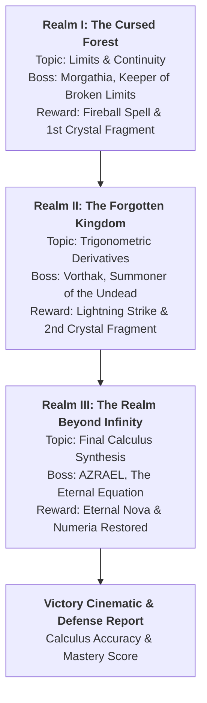

# ⚔️ THE FORBIDDEN REALM: THE TRIALS OF KNOWLEDGE
### A 3D First-Person Fantasy Adventure RPG Featuring Differential Calculus

[](https://github.com/klein-sys/Baroha)
[](https://klein-sys.github.io/Baroha/)
[](https://www.batstate-u.edu.ph/)
[](https://threejs.org/)
[](https://developer.mozilla.org/en-US/docs/Web/API/Web_Audio_API)

> **Batangas State University - The National Engineering University**  
> **College of Informatics and Computing Sciences**  
> **Course:** MATH 101 – Differential Calculus  
> **Semestral Project:** Designing Digital Worlds Through Differential Calculus  
> **Course Facilitators:** Engr. Hilarion S. Aquino III & Engr. James Marvin C. Gatdula  
> **Repository:** [https://github.com/klein-sys/Baroha](https://github.com/klein-sys/Baroha)  
> **Live Gameplay:** [https://klein-sys.github.io/Baroha/](https://klein-sys.github.io/Baroha/)

---

## 🌟 1. Project Overview & Role

**The Forbidden Realm: The Trials of Knowledge** is a complete, playable 3D first-person dark fantasy adventure RPG. This project demonstrates how fundamental concepts of Differential Calculus—including **Limits**, **Continuity**, and **Trigonometric Derivatives**—can serve as the core mechanics driving environmental navigation, spellcraft, enemy encounters, and multi-phase boss battles.

This is **not** a simple quiz website:
- **Playable 3D Environments:** Three distinct procedural realms (Cursed Forest, Medieval Necropolis, Celestial Cosmic Void).
- **First-Person Controls:** 360° camera look, WASD movement, jumping, sprinting, melee sword swinging, and defensive blocking.
- **Dynamic Weapons & Abilities:** 3D animated First-Person Runeblade sword, Magic Bolt, Fireball, Lightning Strike, Magical Shield, Healing Aura, and Eternal Nova.
- **Enemies & Boss AI:** Minion wave pathfinding, projectile dodging, and 3 grand multi-phase boss encounters.
- **Survival Mechanics:** 5 visible Ruby Hearts (lives). In boss combat, mathematical mistakes cost 1 heart; correct answers damage the boss.
- **Organized Settings & Controls Guide:** On-screen quick-access guide `[H]`, customizable graphics quality presets, resolution scaling, render distance fog, FOV, sensitivity, and volume.

---

## 🎮 2. Game Story & Lore

Long ago, the Kingdom of Numeria was safeguarded by the Guardians of Knowledge using the **Sacred Calculus Crystal**. 

The harmonic equilibrium was shattered when an ancient force called the **Forbidden Equation** corrupted the three sacred realms:
1. **The Witch's Cursed Forest** — Guarded by **Morgathia, Keeper of Broken Limits**, who fractured space with discontinuous boundaries.
2. **The Necromancer's Forgotten Kingdom** — Guarded by **Vorthak, Summoner of the Undead**, who shielded his army with oscillating trigonometric derivatives.
3. **The Realm Beyond Infinity** — Guarded by **AZRAEL, THE ETERNAL EQUATION**, who seeks to collapse reality into undefined singularities.

Chosen by the Last Guardian of Knowledge, you wield the enchanted **Runeblade** and an **Apprentice Spellbook**. Your mission is to master calculus, defeat all three corrupted guardians, recover the three Sacred Crystal fragments, and restore harmonic balance to Numeria.

---

## 🕹️ 3. Game Controls & Input Guide

The game is designed for desktop keyboard/mouse and touchscreen mobile devices.

| Key / Input | Action | In-Game Mechanics |
| :--- | :--- | :--- |
| **W, A, S, D** | Movement | Walk forward, left, backward, and right |
| **Mouse Look** | Camera | 360° first-person camera with Pointer Lock |
| **Space** | Jump | Leap over obstacles, ruins, and chasms |
| **Shift** (Hold) | Sprint | Accelerates movement from 8 to 14 units/sec |
| **Left Click (LMB)** | Attack | Swings the 3D Runeblade sword with trail particles |
| **Right Click (RMB)**| Block / Parry | Defensive stance reducing incoming damage by 60% |
| **1, 2, 3, 4, Q** | Spellcasting | Cast Magic Bolt, Fireball, Lightning, Shield, Nova |
| **E / F** | Interact | Speak with NPCs, open chests, collect keys, activate obelisks |
| **Tab** | Quest Journal | View active realm objectives and achievements |
| **I** | Arcane Satchel | Open inventory to consume Healing Potions (+50 HP) or Mana Crystals |
| **C** | Guardian Status | View Level, HP, Mana, Attack Power, and Accuracy % |
| **M** | Calculus Codex | Study formulas, definitions, and worked examples |
| **H** | Controls Guide | Open the interactive Controls & How to Play manual |
| **O** | Settings | Adjust Graphics, Resolution, FOV, Sensitivity, and Audio |
| **Esc / P** | Pause Menu | Pause the game, restart realm, or adjust settings |

> 📱 **Mobile Touch Controls:** When loaded on a phone or tablet, an on-screen virtual joystick (left thumb) and floating action buttons (`SWORD`, `JUMP`, `CAST`, `USE`, `POTION`, `QUEST`, `GUIDE`, `OPT`) appear automatically.

---

## ⚙️ 4. Organized Settings & Adjustable Graphics

Access the Settings Menu via the HUD button `⚙️ SETTINGS [O]`, the Pause Menu, the Main Menu, or by pressing **`O`**.

- **Quality Presets:** `Low (Fast / 720p)`, `Medium (Balanced)`, `High (Recommended / 1080p)`, `Ultra (Max Quality / 1440p+)`.
- **Resolution Scaling:** `0.75x (Performance)`, `1.0x (Native)`, `1.5x (Super-Sampled HD)`.
- **Render Distance / Atmosphere Fog:** `Short (Dense Fog / High FPS)`, `Medium (Balanced)`, `Far (Panoramic Vista)`.
- **Camera FOV:** Customizable slider from **65° to 95°**.
- **Particle & Spell Explosions:** Toggle On/Off for glowing torches, spell projectile trails, and combat embers.
- **Framerate Limiter (FPS Cap):** `30 FPS (Power Saver)`, `60 FPS (Smooth)`, or `Uncapped (Max Display Refresh)`.
- **Controls & Sensitivity:** Mouse sensitivity slider (0.5x to 3.0x), Invert Y-axis toggle, and Mobile UI visibility.
- **Audio System:** Sliders for Master, Music, and SFX volumes + Mute toggle.
- **Persistence:** All preferences are saved automatically in `localStorage`.

---

## 💖 5. Survival & RPG Progression Mechanics

### The Five Hearts (Lives) System
- The player begins with exactly **5 Hearts (Lives)**, visible on the top-left HUD.
- **Physical Damage:** Normal minion attacks deplete your green Health Bar (HP). If your HP falls to 0, you lose **1 Heart** and respawn at the Sanctuary Checkpoint with full HP.
- **Boss Combat Calculus Curses:** In boss encounters, the boss periodically casts mathematical attack spells. An **incorrect answer immediately costs 1 Heart**! A **correct answer deals massive counter-damage** to the boss!
- **Golden Hearts:** Rare collectibles hidden in ruins and mystery chests that restore lost heart containers up to the maximum of 5.
- **Game Over & Checkpoints:** If all 5 Hearts are depleted, you enter the Game Over screen with a **Retry from Checkpoint** option.

### RPG Leveling & Stat Scaling
- Defeating monsters, solving calculus trials, opening mystery chests, and vanquishing bosses awards **Experience Points (XP)**.
- **Level Curve:**
  - **Level 1 (Novice Adventurer):** 100 HP, 100 MP, 35 Attack. Spells: *Magic Bolt*, *Magical Shield*, *Healing Aura*.
  - **Level 2 (Apprentice Mage):** 125 HP, 120 MP, 45 Attack. Unlocks: *Fireball*.
  - **Level 3 (Lich Hunter):** 150 HP, 140 MP, 55 Attack. Unlocks: *Lightning Strike*.
  - **Level 4 (Legendary Guardian):** 175 HP, 160 MP, 65 Attack. Unlocks: *Eternal Nova*.

---

## 🏰 6. The Three Progressive Realms & Boss Encounters



### Level 1: The Witch's Cursed Forest
- **Boss:** *Morgathia, Keeper of Broken Limits* (300 HP, 3 Phases)
- **Environment:** Dark misty woodlands, twisted gothic trees, bioluminescent mushrooms, ruined cottages, and Morgathia's Cursed Castle.
- **Educational Topic: Limits & Continuity**
  - Evaluating limits via direct substitution: $\lim_{x \to 3} (2x^2 - 4x + 5) = 11$.
  - Resolving $\frac{0}{0}$ indeterminate forms by factoring: $\lim_{x \to 4}\frac{x^2 - 16}{x - 4} = 8$.
  - Conjugate multiplication for radical expressions: $\lim_{x \to 0}\frac{\sqrt{x+9}-3}{x} = \frac{1}{6}$.
  - Limits at infinity / horizontal asymptotes: $\lim_{x \to \infty}\frac{6x^2+7x-2}{2x^2-5x+3} = 3$.
  - Determining piecewise parameters $k$ ensuring continuity: $\lim_{x \to c^-} f(x) = \lim_{x \to c^+} f(x)$.
- **Rewards:** 500 XP, *Apprentice Mage* title, unlock **Fireball**, First Sacred Crystal Fragment.

### Level 2: The Necromancer's Forgotten Kingdom
- **Boss:** *Vorthak, Summoner of the Undead* (450 HP, 4 Phases)
- **Environment:** Crumbling gothic cathedral arches, cobblestone avenues, weathered tombstone cemetery, green spectral braziers, and the Crypt Portal.
- **Educational Topic: Basic Trigonometric Derivatives**
  - Fundamental derivatives: $\frac{d}{dx}[\sin x] = \cos x$, $\frac{d}{dx}[\cos x] = -\sin x$, $\frac{d}{dx}[\tan x] = \sec^2 x$.
  - Reciprocal functions: $\frac{d}{dx}[\sec x] = \sec x \tan x$, $\frac{d}{dx}[\csc x] = -\csc x \cot x$, $\frac{d}{dx}[\cot x] = -\csc^2 x$.
  - Trigonometric Chain Rule: $\frac{d}{dx}[\sin(4x)] = 4\cos(4x)$, $\frac{d}{dx}[\cos(3x^2)] = -6x\sin(3x^2)$.
  - Product Rule with Trigonometry: $\frac{d}{dx}[x^2\sin x] = 2x\sin x + x^2\cos x$.
  - Tangent slopes & instantaneous rates of change: $\left. \frac{d}{dx}[3\sin x] \right|_{x=0} = 3$.
- **Summoned Undead:** Skeleton Scholars, Undead Knights, Phantom Mages, and Cursed Guardians.
- **Rewards:** 1,000 XP, *Lich Hunter* title, unlock **Lightning Strike**, Second Sacred Crystal Fragment.

### Level 3: The Realm Beyond Infinity
- **Final Boss:** *AZRAEL, THE ETERNAL EQUATION* (650 HP, 4 Phases)
- **Environment:** Floating celestial marble platforms suspended in cosmic space, orbiting golden mathematical rings, three Ancient Dimensional Towers, and the Grand Final Arena.
- **Educational Topic: Final Calculus Trial**
  - Higher-order trigonometric derivatives: $\frac{d^2}{dx^2}[\cos(2x)] = -4\cos(2x)$.
  - Critical points, local extrema, and concavity tests: $f'(x) = 3x^2 - 3 = 0 \implies x = \pm 1$.
  - Instantaneous rate of change / velocity in physics: $v(t) = s'(t) = 8t - 2$.
  - Multi-step trigonometric limit quotients: $\lim_{x \to 0}\frac{1 - \cos x}{x^2} = 0.5$.
- **Rewards:** 2,000 XP, *Legendary Guardian* title, unlock **Eternal Nova**, Final Sacred Crystal Fragment, Restoration of Numeria Ending Cinematic.

---

## 📐 7. Semestral Project Worked Examples (Defense Guide)

### Worked Example 1: Energy Bridge Stabilization via Limits
- **Course Concept:** Limits of Rational Functions & Removable Discontinuities
- **Context:** In Level 1, a collapsed stone bridge requires determining the limiting altitude as coordinate $x \to 3$:
$$\lim_{x \to 3} \frac{x^2 - 9}{x - 3}$$
- **Step-by-Step Solution:**
  1. Test direct substitution $x = 3$:
     $$\frac{3^2 - 9}{3 - 3} = \frac{0}{0} \quad \text{(Indeterminate Form)}$$
  2. Factor the difference of squares in the numerator:
     $$x^2 - 9 = (x - 3)(x + 3)$$
  3. Cancel the common factor $(x - 3)$ for all $x \ne 3$:
     $$\lim_{x \to 3} \frac{(x - 3)(x + 3)}{x - 3} = \lim_{x \to 3} (x + 3)$$
  4. Substitute $x = 3$:
     $$3 + 3 = 6 \text{ units}$$
- **Gameplay Effect:** Entering the exact limiting value of **6** locks the bridge into continuous alignment, allowing safe passage across the chasm and dealing 35 damage to Morgathia's outer ward.

### Worked Example 2: Overloading the Lich's Shield with Trig Derivatives
- **Course Concept:** Chain Rule with Trigonometric Functions
- **Context:** In Level 2, Lich King Vorthak casts an oscillating necrotic barrier with energy profile $E(t) = 5\sin(3t)$. The player must find the instantaneous rate of change of energy at $t = 0$:
$$\left. \frac{dE}{dt} \right|_{t=0}$$
- **Step-by-Step Solution:**
  1. Let outer function $f(u) = 5\sin(u)$ and inner function $u(t) = 3t$.
  2. Derivative of outer function: $f'(u) = 5\cos(u)$.
  3. Derivative of inner function: $u'(t) = 3$.
  4. Apply Chain Rule:
     $$\frac{dE}{dt} = 5\cos(3t) \cdot 3 = 15\cos(3t)$$
  5. Evaluate at $t = 0$:
     $$\left. \frac{dE}{dt} \right|_{t=0} = 15\cos(0) = 15(1) = 15 \text{ MW/s}$$
- **Gameplay Effect:** Solving for **15** triggers a harmonic overload, shattering Vorthak's invulnerability shield and leaving him vulnerable to physical sword slashes.

### Worked Example 3: Banishing the Forbidden Equation via Second-Order Derivatives
- **Course Concept:** Second-Order Derivatives & Simple Harmonic Motion
- **Context:** In Level 3, Azrael casts an orbital wave equation $\Psi(x) = 2\cos(4x)$. The player must compute the second derivative $\frac{d^2\Psi}{dx^2}$ to tune the Sacred Crystals to anti-phase resonance:
- **Step-by-Step Solution:**
  1. First derivative using chain rule:
     $$\frac{d\Psi}{dx} = 2 \cdot (-\sin(4x)) \cdot 4 = -8\sin(4x)$$
  2. Second derivative using chain rule:
     $$\frac{d^2\Psi}{dx^2} = -8 \cdot (\cos(4x)) \cdot 4 = -32\cos(4x)$$
  3. Interpretation: $\frac{d^2\Psi}{dx^2} = -16\Psi(x)$, demonstrating harmonic oscillation with frequency $\omega = 4$.
- **Gameplay Effect:** The anti-phase wave dissolves Azrael's dimensional tether, initiating the final sequence where all three crystal fragments unite to seal the Forbidden Equation forever.

---

## 💻 8. Technical Architecture & File Directory

```
klein-sys/Baroha/
├── index.html                  # Master application entry point & HUD layout
├── README.md                   # Full academic report, lore, controls & defense guide
├── .gitignore                  # Git ignore rules for clean repository
├── TheForbiddenRealm3D.zip     # Complete offline distributable bundle
├── css/
│   └── style.css               # Dark fantasy styling, HUD, modals, KaTeX math cards
└── js/
    ├── three.min.js            # Three.js r128 3D WebGL engine
    ├── audio.js                # Web Audio API procedural synthesizer (music & SFX)
    ├── calculus.js             # Calculus problem generator, explanations & worked examples
    ├── player.js               # 3D First-Person controller, Runeblade viewmodel, survival
    ├── abilities.js            # Spells (Magic Bolt, Fireball, Lightning, Shield, Nova)
    ├── world.js                # 3D procedural realms, trees, cathedral ruins, floating islands
    ├── enemies.js              # Minion pathfinding AI, projectile attacks & 3 Boss machines
    ├── missions.js             # Quest journal, keys collection tracker & achievements
    ├── inventory.js            # Potions, mana crystals, golden hearts, artifacts
    ├── progression.js          # LocalStorage save/load & level scaling
    ├── settings.js             # Dedicated Settings Manager (graphics, resolution, audio)
    ├── interface.js            # HUD updates, damage numbers, dialogs & touch controls
    ├── game.js                 # Core game loop, combat hit detection & scene manager
    └── main.js                 # Event listeners, menu bindings & initialization
```

---

## 🌐 9. How to Enable GitHub Pages (Play in Browser)

1. Open your repository on GitHub: [https://github.com/klein-sys/Baroha](https://github.com/klein-sys/Baroha).
2. Go to **Settings** (tab at the top right).
3. In the left sidebar, click **Pages** (under the "Code and automation" section).
4. Under **Build and deployment > Branch**:
   - Select **Branch:** `main`
   - Select **Folder:** `/ (root)`
   - Click **Save**.
5. Wait 30–60 seconds. Your game will be live worldwide at:  
   👉 **[https://klein-sys.github.io/Baroha/](https://klein-sys.github.io/Baroha/)**!
